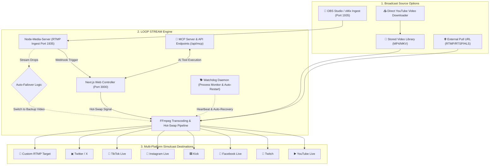

# ⚡ LOOP STREAM by CMAISNAM

<div align="center">

### Professional 24/7 Multi-Destination Live Streaming Station & RTMP Ingest Relay Engine

[](LICENSE)
[](https://nextjs.org/)
[](https://nodejs.org/)
[](https://ffmpeg.org/)
[](#-model-context-protocol-mcp-ai-integration)
[](#-rtmp-ingest-receiver)
[](#-features)

[Features](#-key-features) • [Architecture](#-architecture) • [Quick Start](#-quick-start) • [MCP AI Setup](#-model-context-protocol-mcp-ai-integration) • [OBS Setup](#-obs-studio-setup) • [Production Deployment](#-production-deployment-with-pm2) • [License](#-license)

</div>

---

## 📖 Overview

**LOOP STREAM by CMAISNAM** is a high-performance, self-hosted streaming application designed for broadcasters, creators, and media enterprises. It enables **continuous 24/7 multi-platform live streaming** to YouTube, Twitch, Facebook Live, Kick, Instagram, TikTok, Twitter/X, and custom RTMP destinations simultaneously.

Engineered with a **Single-Encode Pipeline**, LOOP STREAM transcodes incoming media once and relays it to multiple destinations without duplicate CPU/GPU overhead. Built with broadcast redundancy, it features **zero-drop hot-swap video switching**, **OBS Studio / vMix RTMP ingest with automated backup failover**, a **self-healing watchdog daemon**, and native **Model Context Protocol (MCP)** support for controlling broadcasts directly through AI assistants like Claude and Cursor.

---

## ✨ Key Features

- 🔄 **24/7 Continuous Non-Stop Looping**  
  Stream stored video files indefinitely in an endless loop with seamless PTS/DTS timeline synchronization and zero buffer pauses.
- ⚡ **Zero-Drop Hot-Swap Video Switching**  
  Switch the active playing video in a running broadcast on the fly without terminating the live stream or disconnecting viewers on YouTube/Twitch.
- 📡 **Built-in RTMP Ingest Receiver (Port 1935)**  
  Broadcast directly from OBS Studio, vMix, Prism Live, or hardware encoders straight into LOOP STREAM (`rtmp://<server-ip>:1935/live/<streamKey>`) with low-latency HTTP-FLV live stream preview on port 8000.
- 🛡️ **Automated Failover & Backup Loop Logic**  
  If your OBS Studio or incoming live feed drops, the engine instantly switches output to a designated backup loop video. When OBS reconnects, it seamlessly transitions back to the live feed.
- 🌐 **Multi-Platform Simulcast (Single-Encode)**  
  Broadcast simultaneously to YouTube, Twitch, Facebook, Kick, Instagram, TikTok, X, and Custom RTMP targets from a single encode pass.
- 🤖 **Model Context Protocol (MCP) AI Integration** *(New)*  
  Full MCP server and interactive console (`/mcp`) allowing AI assistants (Claude Desktop, Cursor, ChatGPT) to start/stop streams, hot-swap videos, inspect system health, and manage your library via natural language.
- 🐕 **Automated Stream Watchdog Service** *(New)*  
  A dedicated background daemon (`scripts/watchdog-service.js`) continuously monitors active streams and FFmpeg processes, automatically recovering and restarting failed broadcasts for true 24/7 reliability.
- 📥 **Direct YouTube Video Import** *(New)*  
  Import videos directly from YouTube URLs into your library with format/resolution selection (1080p, 720p, etc.) and Netscape cookie support (`/settings`) to bypass bot verification.
- 🔑 **API Key & Credential Management** *(New)*  
  Generate and revoke API keys with custom labels, view audit logs, and manage credentials with hardened bcrypt authentication.
- 🎨 **Ultra-Modern Monochrome Glassmorphism UI**  
  High-contrast black & white design system featuring backdrop blur effects, responsive cards, interactive modals, and real-time status indicators.
- 📊 **Hardware & Broadcast Telemetry**  
  Real-time server CPU, RAM, disk utilization, active FFmpeg process counts, live output FPS, and network bitrate meters.

---

## 🏗️ Architecture



---

## 📋 System Requirements

| Resource | Minimum | Recommended (Multi-Stream) |
|---|---|---|
| **OS** | Linux (Ubuntu 20.04/22.04/24.04), Debian, macOS | Ubuntu 22.04 / 24.04 LTS (x86_64) |
| **CPU** | 2 Cores | 4+ Cores (for simultaneous 1080p multi-streaming) |
| **RAM** | 2 GB | 4 GB - 8 GB |
| **Storage** | 20 GB SSD | 100+ GB SSD (for media storage) |
| **Bandwidth** | 5 Mbps upload | 25+ Mbps upload per concurrent stream |
| **Software** | Node.js 18.x+, FFmpeg 4.4+, Python 3 | Node.js 20.x, FFmpeg 6.x+, yt-dlp |

---

## 🚀 Quick Start

### 1. Clone the Repository

```bash
git clone https://github.com/kangleiamv/Loop-Stream.git
cd Loop-Stream
```

### 2. Install System Dependencies (Ubuntu / Debian)

```bash
sudo apt update
sudo apt install -y nodejs npm ffmpeg build-essential python3 python3-pip
```

Optional: Install `yt-dlp` for YouTube video imports:
```bash
sudo curl -L https://github.com/yt-dlp/yt-dlp/releases/latest/download/yt-dlp -o /usr/local/bin/yt-dlp
sudo chmod a+rx /usr/local/bin/yt-dlp
```

### 3. Install NPM Packages

```bash
npm install
```

### 4. Configure Environment Variables

Copy `.env.example` to `.env.local`:

```bash
cp .env.example .env.local
```

Configure `.env.local`:

```env
# Server Port
PORT=3000
NODE_ENV=production

# Security & Session (generate with: openssl rand -base64 32)
SESSION_SECRET=replace_with_a_long_random_secret_string_32_chars_min

# Authentication Credentials
ADMIN_USERNAME=admin
ADMIN_PASSWORD_HASH=$2a$10$bnBPpvGuYqqJ1bezIh1the1T87myl/lh0nNIrDNvWF.D02QsoVc46 # Default: admin123

# Database & File Storage
DATABASE_PATH=./data/streams.db
UPLOAD_DIR=./public/uploads
MAX_FILE_SIZE=2147483648
```

> **Tip**: Default credentials are **Username:** `admin` | **Password:** `admin123`.

### 5. Initialize Database & Run

```bash
# Initialize SQLite database
node scripts/setup-db.js

# Build and start Next.js
npm run build
npm start
```

Access the dashboard at: `http://localhost:3000`

---

## 🛠️ Production Deployment with PM2

For robust 24/7 background operation, LOOP STREAM includes a multi-service PM2 ecosystem:

1. **`qc-live`**: Next.js Web Controller & API
2. **`loopstream-rtmp`**: NodeMediaServer RTMP Ingest & HTTP-FLV daemon
3. **`loopstream-watchdog`**: Autonomous stream health monitor & auto-restart watchdog

### 1. Install PM2 Globally

```bash
sudo npm install -g pm2
```

### 2. Build the Application

```bash
npm run build
```

### 3. Launch with PM2

```bash
pm2 start ecosystem.config.js
pm2 save
pm2 startup
```

### 4. Monitor Services

```bash
pm2 list
pm2 logs
```

```
┌────┬────────────────────┬──────────┬──────┬───────────┬──────────┬──────────┐
│ id │ name               │ mode     │ ↺    │ status    │ cpu      │ memory   │
├────┼────────────────────┼──────────┼──────┼───────────┼──────────┼──────────┤
│ 0  │ qc-live            │ fork     │ 0    │ online    │ 0%       │ 98.0mb   │
│ 1  │ loopstream-rtmp    │ fork     │ 0    │ online    │ 0.1%     │ 25.0mb   │
│ 2  │ loopstream-watchdog│ fork     │ 0    │ online    │ 0.1%     │ 22.0mb   │
└────┴────────────────────┴──────────┴──────┴───────────┴──────────┴──────────┘
```

---

## 🤖 Model Context Protocol (MCP) AI Integration

Control LOOP STREAM using natural language through AI assistants (Claude Desktop, Cursor, ChatGPT) via the built-in MCP server.

### Available MCP Tools:
- `list_streams`: Inspect all streams, statuses, sources, and destinations.
- `start_stream`: Launch a stream by ID.
- `stop_stream`: Terminate an active stream.
- `switch_video`: Hot-swap the playing video in an active broadcast with zero stream drops.
- `list_videos`: Retrieve the library of uploaded and downloaded videos.
- `get_system_stats`: View CPU, memory, storage, and active broadcast health.

### Claude Desktop Configuration

Add the following to your `claude_desktop_config.json`:

```json
{
  "mcpServers": {
    "loopstream": {
      "command": "node",
      "args": ["/absolute/path/to/Loop-Stream/QC-Live/scripts/mcp-server.js"],
      "env": {
        "LOOPSTREAM_URL": "http://127.0.0.1:3000",
        "LOOPSTREAM_API_KEY": "YOUR_API_KEY_FROM_SETTINGS_PAGE"
      }
    }
  }
}
```

### Cursor Setup

In **Cursor Settings** → **Features** → **MCP Servers**, add:
* **Name:** `loopstream`
* **Type:** `command`
* **Command:** `node /absolute/path/to/Loop-Stream/QC-Live/scripts/mcp-server.js`

Generate and manage your API keys directly from the `/settings` or `/mcp` web interface.

---

## 📡 OBS Studio Setup Guide

Broadcast directly from OBS Studio to LOOP STREAM and relay out to all platforms simultaneously:

1. Open **OBS Studio** → **Settings** → **Stream**.
2. **Service**: Select `Custom...`
3. **Server**: `rtmp://<YOUR_SERVER_IP>:1935/live`
4. **Stream Key**: Enter the Stream Key configured for your stream (e.g., `obs_channel_1` or generate one in `/rtmp`).
5. **Video Settings in OBS**:
   - Resolution: `1920x1080` or `1280x720`
   - Output Mode: `Advanced`
   - Rate Control: `CBR`
   - Bitrate: `3500 - 6000 Kbps`
   - Keyframe Interval: `2 seconds` (Recommended for YouTube/Twitch)
   - Tune: `zerolatency`
6. Click **Start Streaming** in OBS Studio.

> ⚡ **Zero-Drop Failover**: When OBS disconnects, LOOP STREAM automatically switches the broadcast to your configured fallback video without dropping the live stream on YouTube or Twitch!

---

## 🌐 Nginx Reverse Proxy & SSL Configuration

To access the panel over HTTPS with a custom domain, configure Nginx:

```nginx
# /etc/nginx/sites-available/loopstream
server {
    listen 80;
    server_name stream.yourdomain.com;

    # Redirect HTTP to HTTPS
    return 301 https://$host$request_uri;
}

server {
    listen 443 ssl http2;
    server_name stream.yourdomain.com;

    # SSL Certificates (managed by Certbot)
    ssl_certificate /etc/letsencrypt/live/stream.yourdomain.com/fullchain.pem;
    ssl_certificate_key /etc/letsencrypt/live/stream.yourdomain.com/privkey.pem;

    # Client upload limit for large video files
    client_max_body_size 2G;

    # Next.js Web Panel
    location / {
        proxy_pass http://127.0.0.1:3000;
        proxy_http_version 1.1;
        proxy_set_header Upgrade $http_upgrade;
        proxy_set_header Connection 'upgrade';
        proxy_set_header Host $host;
        proxy_cache_bypass $http_upgrade;
        proxy_set_header X-Real-IP $remote_addr;
        proxy_set_header X-Forwarded-For $proxy_add_x_forwarded_for;
        proxy_set_header X-Forwarded-Proto $scheme;
    }

    # HTTP-FLV Live Preview Stream
    location /live {
        proxy_pass http://127.0.0.1:8000;
        proxy_http_version 1.1;
        proxy_set_header Host $host;
        proxy_buffering off;
    }
}
```

Enable site and configure SSL:
```bash
sudo ln -s /etc/nginx/sites-available/loopstream /etc/nginx/sites-enabled/
sudo nginx -t
sudo systemctl reload nginx
sudo certbot --nginx -d stream.yourdomain.com
```

### Firewall Configuration (UFW)

```bash
sudo ufw allow 80/tcp     # HTTP Web Panel
sudo ufw allow 443/tcp    # HTTPS Web Panel
sudo ufw allow 1935/tcp   # RTMP Ingest (OBS / vMix)
sudo ufw allow 8000/tcp   # HTTP-FLV Preview (optional)
sudo ufw enable
```

---

## 🎯 Multi-Platform Destination Presets

Enter one or more RTMP destination URLs separated by newlines in the **Destinations** field:

### 1. YouTube Live
* **RTMP URL**: `rtmp://a.rtmp.youtube.com/live2/<STREAM_KEY>`
* **Backup URL**: `rtmp://b.rtmp.youtube.com/live2?backup=1/<STREAM_KEY>`

### 2. Twitch
* **RTMP URL**: `rtmp://live.twitch.tv/app/<STREAM_KEY>`

### 3. Facebook Live
* **RTMP URL**: `rtmps://live-api-s.facebook.com:443/rtmp/<STREAM_KEY>`

### 4. Kick
* **RTMP URL**: `rtmps://fa723fc1b171.global-contribute.live-video.net/app/<STREAM_KEY>`

### 5. Instagram Live / TikTok Live
* Use your stream key provider:
* **RTMP URL**: `rtmps://live-upload.instagram.com:443/rtmp/<STREAM_KEY>`

---

## ⚡ Zero-Drop Hot-Swap Video Switching

Need to change the playing video during a 24/7 stream without terminating the broadcast?

1. Navigate to **Streams** in the navigation bar.
2. On any running stream card, click **⚡ Switch Video**.
3. Select a new video from your library.
4. Click **Apply Switch Now**.
5. The station automatically hot-swaps the video input buffer in real-time. Viewers on YouTube and Twitch experience zero buffering and no stream termination!

---

## 📁 Project Structure

```
QC-Live/
├── components/           # Monochrome Glassmorphism UI Components
│   ├── EditStreamModal.tsx
│   ├── Layout.tsx
│   ├── PlatformIcon.tsx
│   ├── StreamCard.tsx
│   ├── StreamForm.tsx
│   ├── SwitchVideoModal.tsx
│   ├── VideoLibrary.tsx
│   ├── VideoPreview.tsx
│   └── VideoUpload.tsx   # Video file upload & YouTube importer
├── lib/                  # Core Business Logic
│   ├── auth.ts           # Authentication & session token verification
│   ├── authMiddleware.ts # API route protection & API key validation
│   ├── database.ts       # SQLite3 database connection & schema
│   ├── ffmpeg.ts         # Broadcast transcoding & zero-drop hot-swap engine
│   ├── platforms.ts      # Multi-platform simulcast presets & icons
│   ├── streamState.ts    # In-memory stream lifecycle registry
│   └── youtubeCookies.ts # Netscape cookie parser for YouTube downloads
├── pages/                # Next.js Pages & API Endpoints
│   ├── api/
│   │   ├── auth/         # Login, logout, session verification
│   │   ├── mcp/          # MCP tools & status endpoint
│   │   ├── rtmp/         # Webhooks, receiver status, key generator
│   │   ├── settings/     # API keys & cookie configuration endpoints
│   │   ├── streams/      # Create, start, stop, switch-video, delete
│   │   ├── system/       # CPU, RAM, disk, and process telemetry
│   │   └── videos/       # Upload, YouTube download, list, delete
│   ├── dashboard/        # Metrics, simulcast matrix, system health
│   ├── mcp/              # MCP Server interactive console & setup guide
│   ├── rtmp/             # RTMP Ingest console & OBS credentials
│   ├── settings/         # API key & YouTube cookie management
│   ├── streams/          # Stream management & multi-card monitor
│   └── videos/           # Media asset library & video uploader
├── public/               # Static assets & uploads directory
├── scripts/
│   ├── mcp-server.js     # Standalone stdio MCP server for Claude/Cursor
│   ├── rtmp-service.js   # Standalone NodeMediaServer RTMP/HTTP-FLV daemon
│   ├── setup-db.js       # SQLite database initialization
│   └── watchdog-service.js # Autonomous 24/7 crash recovery daemon
├── ecosystem.config.js   # Production PM2 multi-process configuration
└── styles/globals.css    # Tailwind CSS & glassmorphism theme tokens
```

---

## ❓ Frequently Asked Questions

<details>
<summary><b>Can I stream 24/7 without a GPU?</b></summary>
Yes! The FFmpeg pipeline uses the ultra-optimized <code>libx264</code> software encoder with custom tuning presets. A modern 2 to 4-core cloud VPS easily handles 720p or 1080p continuous 24/7 streaming.
</details>

<details>
<summary><b>How does the Watchdog Service protect my streams?</b></summary>
The Watchdog daemon (<code>scripts/watchdog-service.js</code>) checks active streams every 15 seconds. If an FFmpeg process unexpectedly terminates or crashes, the watchdog immediately relaunches the stream without human intervention.
</details>

<details>
<summary><b>Does switching videos break YouTube monetization or viewer count?</b></summary>
No! Because the RTMP stream pipe to YouTube never drops, YouTube treats the switch as continuous live video. Chat, concurrent viewer counters, and live recording remain completely intact.
</details>

<details>
<summary><b>Can I broadcast to vertical platforms like TikTok and Instagram?</b></summary>
Yes! LOOP STREAM includes vertical resolution presets (720x1280 and 1080x1920) specifically designed for TikTok, Instagram Reels, and YouTube Shorts live formats.
</details>

---

## 📄 License

This project is licensed under the **MIT License** - see the [LICENSE](LICENSE) file for details.

---

## 👨‍💻 Author & Credits

Designed and engineered with ❤️ by **CMAISNAM** & **kangleiamv**  
* GitHub: [kangleiamv/Loop-Stream](https://github.com/kangleiamv/Loop-Stream)  
* Project: **LOOP STREAM**

---

<div align="center">
  <b>LOOP STREAM</b> • Continuous 24/7 Multi-Stream & Relay Station • © 2026 All Rights Reserved
</div>
